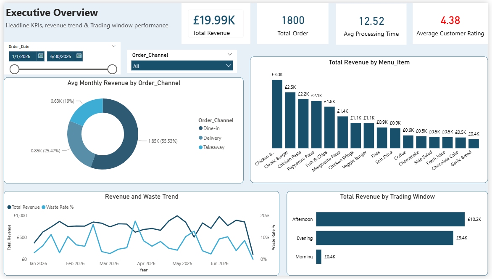
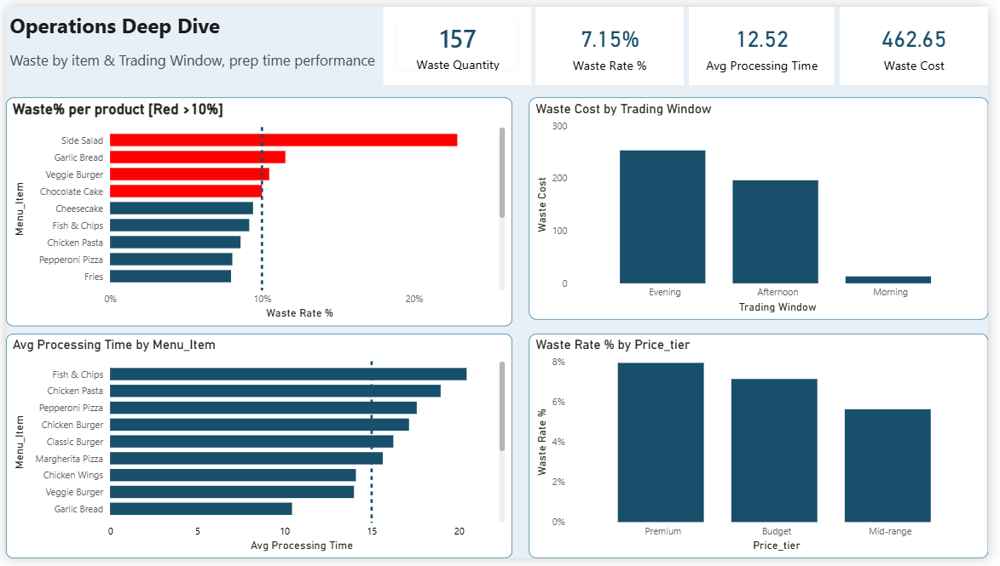
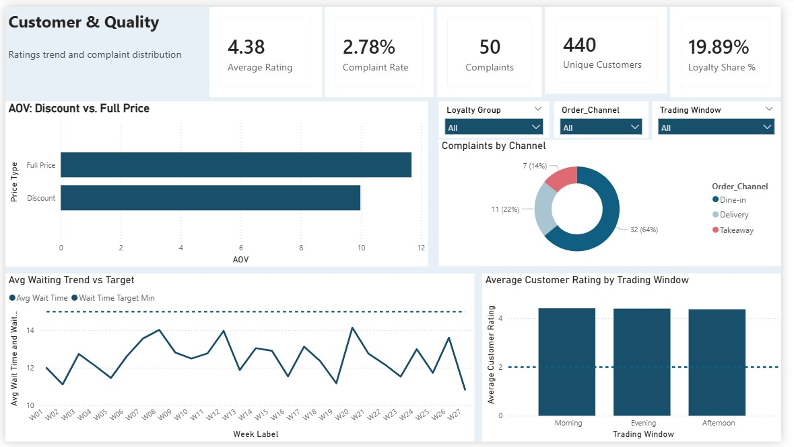
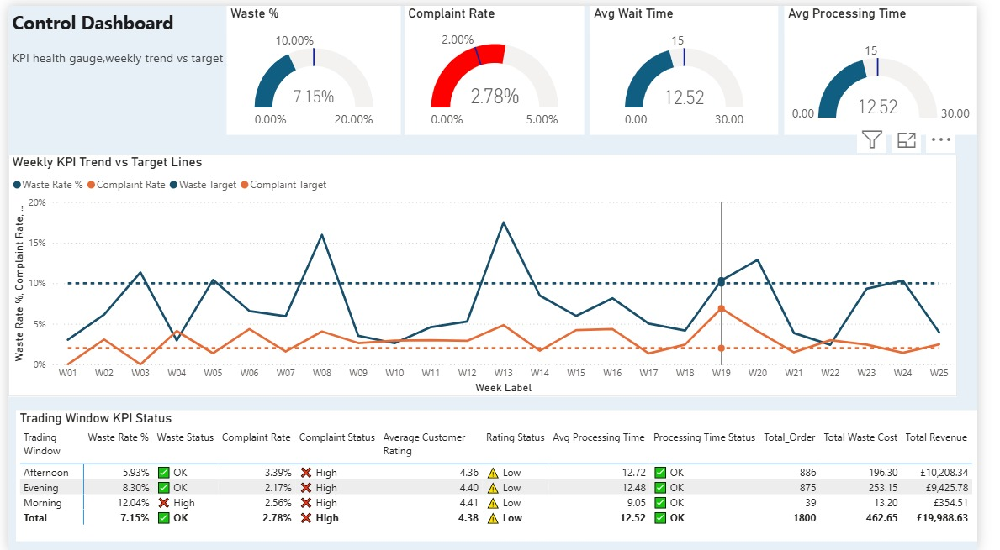

# 🍽️ Turning Data Into Delicious Decisions
### Restaurant Performance Analysis-6-Month Review (Jan–Jun 2026)
[](https://www.microsoft.com/en-gb/sql-server)
[](https://www.microsoft.com/en-gb/microsoft-365/excel)
[](https://powerbi.microsoft.com/)


</div>


---

## 📑 Table of Contents

- [About This Project](https://github.com/Deborah-Eke/Restaurant_Analysis/blob/main/README.md#-about-this-project)
- [The Client Problem](https://github.com/Deborah-Eke/Restaurant_Analysis/blob/main/README.md#-the-client-problem)
- [Dataset Overview](https://github.com/Deborah-Eke/Restaurant_Analysis/blob/main/README.md#-dataset-overview)
- [Data Dictionary](https://github.com/Deborah-Eke/Restaurant_Analysis/blob/main/README.md#-data-dictionary)
- [Project Workflow](https://github.com/Deborah-Eke/Restaurant_Analysis/blob/main/README.md#-project-workflow)
- [Tools Used](https://github.com/Deborah-Eke/Restaurant_Analysis/blob/main/README.md#%EF%B8%8F-tools-used)
- [Data Cleaning Process](https://github.com/Deborah-Eke/Restaurant_Analysis/blob/main/README.md#-data-cleaning-process)
- [Exploratory Data Analysis](https://github.com/Deborah-Eke/Restaurant_Analysis/blob/main/README.md#-exploratory-data-analysis)
- [Dashboards Overview](https://github.com/Deborah-Eke/Restaurant_Analysis/blob/main/README.md#-dashboards-overview)
- [Key Insights](https://github.com/Deborah-Eke/Restaurant_Analysis/blob/main/README.md#-key-insights)
- [Business Recommendations](https://github.com/Deborah-Eke/Restaurant_Analysis/blob/main/README.md#-business-recommendations)
- [Expected Impact](https://github.com/Deborah-Eke/Restaurant_Analysis/blob/main/README.md#-expected-impact)
- [Implementation Plan](https://github.com/Deborah-Eke/Restaurant_Analysis/blob/main/README.md#-implementation-plan)
- [Project Structure](https://github.com/Deborah-Eke/Restaurant_Analysis/blob/main/README.md#-project-structure)
- [About Me](https://github.com/Deborah-Eke/Restaurant_Analysis/blob/main/README.md#%E2%80%8D-about-me)

---

## 📌 About This Project

This project is a full-cycle restaurant performance analysis covering **1,800 transactions** across a 6-month period (January to June 2026). Working as a Data Analyst Intern with Team Oreo, I used **SQL Server**, **Microsoft Excel**, and **Power BI** to clean, explore, and visualise the data, ultimately producing 4 interactive dashboards and a set of data-driven recommendations to improve profitability, reduce waste, and improve customer satisfaction.

> **My role:** End-to-end data analyst — from raw data ingestion and cleaning in SQL Server, through pivot-table EDA in Excel, to a fully published 4-page Power BI report with DAX-calculated KPIs.

**Project Title:** *Turning Data Into Delicious Decisions*    
**Organisation:** Team Oreo

---

## 🔴 The Client Problem

The restaurant approached us with **three core pain points**:

| # | Problem | Why It Matters |
|---|---------|----------------|
| 1 | **Waste is costly** | Food waste directly erodes gross profit margin |
| 2 | **Customer complaints are rising** | Complaint rate exceeded the 2% internal target |
| 3 | **Delivery prep is too slow** | Long preparation times are damaging delivery experience |

These problems were backed by data — but the restaurant had no single view of performance. My task was to build that visibility.

---

## 📊 Dataset Overview

| Attribute | Detail |
|-----------|--------|
| **Source** | Legacy Group internal POS system |
| **Period** | 1 January 2026 – 30 June 2026 |
| **Rows (raw)** | 1,810 transactions |
| **Rows (after cleaning)** | 1,800 transactions (10 duplicates removed) |
| **Columns** | 24 |
| **Unique Customers** | 440 |
| **Menu Items** | 16 |
| **Order Channels** | Dine-in, Delivery, Takeaway |
**Key financial figures confirmed in the cleaned dataset:**

| KPI | Value |
|-----|-------|
| Total Net Revenue | £19,988.63 |
| Total Gross Profit | £13,521.88 |
| Total Food Cost | £6,466.75 |
| Total Waste Cost | £462.65 |
| Total Discount Given | £745.62 |
| Average Order Value | £11.10 |
| Gross Profit Margin | 67.6% |

---

## 📖 Data Dictionary

| Column Name | Data Type | Description | Example Value |
|-------------|-----------|-------------|---------------|
| `Transaction_ID` | VARCHAR | Unique identifier for each individual transaction record | TX-500001 |
| `Order_ID` | VARCHAR | Unique identifier for each customer order (one order may contain multiple items) | ORD-10001 |
| `Order_Date` | DATE | The calendar date the order was placed | 2026-01-15 |
| `Order_Time` | TIME | The time of day the order was placed | 14:17:00 |
| `Day_of_Week` | VARCHAR | Day name corresponding to the order date | Saturday |
| `Customer_ID` | VARCHAR | Unique identifier for each customer | CUST-1288 |
| `Customer_Segment` | VARCHAR | Customer loyalty classification: New, Returning, or Loyal | Returning |
| `Order_Channel` | VARCHAR | How the order was placed — Dine-in, Delivery, or Takeaway | Dine-in |
| `Menu_Item` | VARCHAR | Name of the food or drink item ordered | Margherita Pizza |
| `Category` | VARCHAR | Product category grouping — Main, Starter, Side, Dessert, Drink | Main |
| `Quantity` | INT | Number of units of the menu item ordered | 1 |
| `Unit_Price_GBP` | DECIMAL | Listed selling price per single unit, in GBP | £10.50 |
| `Gross_Sales_GBP` | DECIMAL | Total revenue before discount: Quantity × Unit_Price_GBP | £10.50 |
| `Discount_Percent` | DECIMAL | Percentage discount applied to this transaction, if any | 5.00 |
| `Discount_Value_GBP` | DECIMAL | Pound value of the discount deducted | £0.53 |
| `Net_Sales_GBP` | DECIMAL | Actual revenue collected after discount: Gross_Sales − Discount_Value | £9.97 |
| `Food_Cost_GBP` | DECIMAL | Cost of ingredients to produce this item | £3.20 |
| `Gross_Profit_GBP` | DECIMAL | Profit on this item: Net_Sales − Food_Cost | £6.77 |
| `Waste_Quantity` | INT | Number of units wasted in this transaction (0 = no waste) | 1 |
| `Waste_Cost_GBP` | DECIMAL | Monetary value of wasted items: Waste_Quantity × Food_Cost_per_unit | £3.20 |
| `Waste_Reason` | VARCHAR | Reason waste occurred: Expired Stock, Overproduction, Preparation Error, Damaged, or NULL | Expired Stock |
| `Preparation_Time_Min` | INT | Minutes taken to prepare and fulfil the order | 9 |
| `Customer_Rating` | DECIMAL | Customer satisfaction score for this order, on a scale of 1.0 to 5.0 | 4.3 |
| `Complaint_Received` | VARCHAR | Whether the order generated a customer complaint: Yes or No | No |
| `Payment_Method` | VARCHAR | How the customer paid — Card, Cash, Apple Pay, Google Pay | Card |
| `Staff_ID` | VARCHAR | Identifier for the member of staff who handled the order | EMP-106 |
| `Price_Tier` | VARCHAR | Product price tier classification — Premium, Mid-range, or Budget | Mid-range |
| `Trading_Window` | VARCHAR | Time-of-day operating period — Morning, Afternoon, or Evening | Afternoon |
| `Week_Label` | VARCHAR | ISO-style week identifier for weekly trend analysis | W01 |
| `Month` | VARCHAR | Calendar month of the order, used for monthly trend aggregation | January 2026 |

---

## 🔄 Project Workflow

My analysis followed the same structure as the client-facing presentation: from problem identification through to final recommendations.

```
┌─────────────────────────────────────────────────────────────────┐
│                     PROJECT WORKFLOW                            │
└─────────────────────────────────────────────────────────────────┘

  RAW DATA (1,810 rows × 24 cols)
       │
       ▼
  ┌─────────────────────────────────────┐
  │         DATA CLEANING               │
  │  ┌──────────┐ ┌────────┐ ┌───────┐  │
  │  │SQL Server│ │ Excel  │ │PowerBI│  │
  │  │(T-SQL)   │ │(PivotT)│ │ (DAX) │  │
  │  └──────────┘ └────────┘ └───────┘  │
  └─────────────────────────────────────┘
       │
       ▼
  DATA VALIDATION (1,800 clean rows confirmed)
       │
       ▼
  EXPLORATORY DATA ANALYSIS
  (Revenue trends · Waste · Complaints · Products)
       │
       ▼
  ┌──────────┬──────────┬──────────┬──────────┐
  │Dashboard1│Dashboard2│Dashboard3│Dashboard4│
  │Executive │Operations│Customer &│ Control  │
  │Overview  │Deep Dive │ Quality  │Dashboard │
  └──────────┴──────────┴──────────┴──────────┘
       │
       ▼
  INSIGHTS (13 key findings)
       │
       ▼
  RECOMMENDATIONS (5 actionable strategies)
```

---

## 🛠️ Tools Used

###  Microsoft SQL Server (T-SQL)
Used for all primary data cleaning and initial exploration. I created a dedicated database (`TeamOreo_Restaurant`), imported the raw dataset, and performed all deduplication, NULL handling, and standardisation in T-SQL before exporting the clean file.

###  Microsoft Excel
Used for exploratory data analysis after cleaning. I built pivot tables to analyse product performance, revenue by trading window, discount patterns, and waste-to-food-cost ratios. Excel also served as the source workbook for KPI summary tables shared with the team.

###  Power BI Desktop
Used to build the final 5-page interactive report (4 analytical dashboards + 1 data notes page). I wrote all DAX measures from scratch, configured slicers, KPI cards, gauges, conditional colouring, and dual-axis trend lines.

---

## 🧹 Data Cleaning Process

All cleaning was performed in **SQL Server (T-SQL)** using my Week 1 assignment script.

### Step 1 — Database and table creation
Created a dedicated database `TeamOreo_Restaurant` and defined the `Restaurant_Raw_Data` schema with correct data types for all 30 columns.

### Step 2 — Data import verification
Confirmed successful import: `SELECT COUNT(*) AS Total_Rows` returned 1,800 rows. Ran `SELECT TOP 10 *` to visually inspect column values before any modifications.

### Step 3 — Missing value audit
Used `SUM(CASE WHEN column IS NULL THEN 1 ELSE 0 END)` across all key columns to quantify nulls. Key findings:
- `Customer_Segment`: nulls present → imputed as `'Unknown'`
- `Payment_Method`: nulls present → imputed as `'Unknown'`
- `Waste_Reason`: 1,675 NULLs (expected — only 125 rows had actual waste) → imputed as `'Unspecified'` where `Waste_Quantity > 0`

### Step 4 — Duplicate detection and removal
```sql
-- Identified duplicates by Transaction_ID
SELECT Transaction_ID, COUNT(*) AS Number_of_Records
FROM team_oreo_restaurant_internship_dataset
GROUP BY Transaction_ID
HAVING COUNT(*) > 1;

-- Removed using ROW_NUMBER window function
WITH CleanedData AS (
  SELECT *,
    ROW_NUMBER() OVER (
      PARTITION BY Transaction_ID
      ORDER BY Transaction_ID
    ) AS RowNumber
  FROM team_oreo_restaurant_internship_dataset
)
SELECT * INTO team_oreo_restaurant_internship_dataset_Cleaneds
FROM CleanedData WHERE RowNumber = 1;
```

### Step 5 — Product name standardisation
Applied `LTRIM/RTRIM` to remove leading/trailing whitespace from `Menu_Item`. Fixed the known typo:
```sql
UPDATE team_oreo_restaurant_internship_dataset_Cleaneds
SET Menu_Item = 'Margherita Pizza'
WHERE Menu_Item = 'Margherita Pzza';
```

### Step 6 — Net Sales recalculation
```sql
UPDATE team_oreo_restaurant_internship_dataset_Cleaneds
SET Net_Sales_GBP = ROUND(
  (Quantity * Unit_Price_GBP) - Discount_Value_GBP, 2
);
```

### Step 7 — Validation queries
Ran post-cleaning checks: total revenue (`£19,988.63`), total orders, average order value (`£11.10`), best-selling products, waste percentage, and complaint rate — all confirmed against expected values.

---

## 🔍 Exploratory Data Analysis

After cleaning, I used **Excel pivot tables** and **SQL queries** to answer key business questions:

**Revenue Analysis**
- Monthly revenue grew from £3,204.66 (Jan) to £3,611.71 (Jun) — a **+12.7% increase**
- Afternoon (886 orders) and Evening (875 orders) dominate; Morning accounts for only 39 orders (2.2%)
- Top revenue product: **Chicken Burger £3,015.29** | Bottom: **Garlic Bread £407.80**

**Order Channel Analysis**
- Dine-in: **1,001 orders (55.6%)** | Delivery: 460 | Takeaway: 339
- 34.3% of all orders received a discount (618 of 1,800)

**Waste Analysis**
- Total waste: **£462.65** against food cost of £6,466.75 = **7.15% waste rate**
- Products most above 10% waste threshold: Side Salad (22%), Garlic Bread (14%), Veggie Burger (12%)

**Complaint Analysis**
- Overall complaint rate: **2.78%** (50 complaints from 1,800 orders)
- By channel: Dine-in 3.20% | Delivery 2.39% | Takeaway 2.06%
- 64% of all complaints originated from the **Dine-in channel**

**Customer Analysis**
- Loyalty member share: **19.89%** (target: 25%)
- AOV full-price orders: £11.40 | AOV discounted orders: £10.10
- Average customer rating: **4.38★** (target: 4.5★)

---

## 📊 Dashboards Overview

My Power BI report contains **4 analytical dashboards** and 1 supporting data notes page.

---

### Dashboard 1 — Executive Overview

> *High-level financial and operational summary for senior management*



**KPIs displayed:** £19.99K Total Revenue · 1,800 Total Orders · 12.52 min Avg Processing Time · 4.38 Avg Customer Rating *(shown in red — below 4.5★ target)*

**Visuals:** Date range slicer (Jan–Jun 2026) and Order Channel dropdown · Donut chart showing avg monthly revenue by channel — Dine-in 55.53% (£1.85K), Takeaway 25.47% (£0.85K), Delivery 19% (£0.63K) · Column bar chart ranking all 16 menu items by total revenue — Chicken Burger leads at ~£3.0K, Garlic Bread lowest at ~£0.4K · Dual-axis line chart overlaying total revenue trend and waste rate month-by-month (Jan–Jun 2026) · Horizontal bar chart showing revenue by trading window — Afternoon £10.2K, Evening £9.4K, Morning £0.4K

**What this page tells the business:** Revenue is growing (+12.7% over the period), dine-in dominates sales at over half of monthly revenue, and the customer rating sitting below target signals a service quality gap that needs addressing before it reverses the growth trend.

---

### Dashboard 2 — Operations Deep Dive

> *Food waste by product and trading window, and preparation time by item*



**KPIs displayed:** 157 Waste Quantity · 7.15% Waste Rate % · 12.52 min Avg Processing Time · £462.65 Waste Cost

**Visuals:** Horizontal bar chart of waste % per product — colour-coded red for items exceeding the 10% threshold: **Side Salad (~22%), Garlic Bread (~14%), Veggie Burger (~12%), Chocolate Cake (~10%)** with a dashed target line · Column chart showing waste cost by trading window — Evening £253.15, Afternoon £196.30, Morning £13.20 · Horizontal bar chart of avg processing time per menu item — Fish & Chips (~21 min) and Chicken Pasta (~20 min) are the two slowest · Column chart of waste rate % by price tier — Premium ~8%, Budget ~7%, Mid-range ~6%

**What this page tells the business:** The overall 7.15% waste rate looks healthy, but the product-level chart exposes four items above the 10% threshold that the headline number hides. Evening trading generates the most waste cost despite Afternoon generating more revenue — a sign of end-of-service overproduction. Fish & Chips and Chicken Pasta are the two bottleneck items driving preparation time complaints.

---

### Dashboard 3 — Customer & Quality

> *Satisfaction scores, complaint distribution, loyalty programme health, and discount impact*



**KPIs displayed:** 4.38 Avg Rating · 2.78% Complaint Rate · 50 Total Complaints · 440 Unique Customers · 19.89% Loyalty Share %

**Visuals:** Slicers for Loyalty Group, Order Channel, and Trading Window · Horizontal bar comparing AOV for full-price (~£11.40) vs discounted (~£10.10) orders · Donut chart of complaints by channel — **Dine-in 32 complaints (64%)**, Delivery 11 (22%), Takeaway 7 (14%) · Weekly line chart tracking avg wait time vs the 15-minute target from W01 to W27 · Column chart showing average customer rating by trading window — Morning (4.41), Evening (4.40), Afternoon (4.36) — all below the 4.5★ target

**What this page tells the business:** The complaint donut is the standout visual — 64% of complaints from Dine-in despite it representing just over half of orders points to a specific service quality problem in that channel. Loyalty share at 19.89% is 5 percentage points below target, and the AOV gap shows discounting costs ~£1.30 per order across 34% of all transactions.

---

### Dashboard 4 — Control Dashboard

> *Real-time KPI health gauges, weekly trend lines, and trading window status at a glance*



**KPIs displayed (gauges):** Waste % 7.15% ✅ (target 10%) · Complaint Rate 2.78% 🔴 (target 2% — **above target, gauge shown in red**) · Avg Wait Time 12.52 min ✅ (target 15) · Avg Processing Time 12.52 min ✅ (target 15)

**Visuals:** 4 semi-circular gauge charts with target markers — Complaint Rate gauge is red, all others teal · Multi-series line chart plotting Waste Rate % and Complaint Rate weekly from W01–W25, with dashed target lines · Conditional-formatted KPI status table across all trading windows:

| Trading Window | Waste Rate | Complaint Rate | Avg Rating | Processing | Orders | Revenue |
|---|---|---|---|---|---|---|
| Afternoon | 5.93% ✅ | 3.39% ❌ | 4.36 ⚠️ | 12.72 ✅ | 886 | £10,208.34 |
| Evening | 8.30% ✅ | 2.17% ❌ | 4.40 ⚠️ | 12.48 ✅ | 875 | £9,425.78 |
| Morning | 12.04% ❌ | 2.56% ❌ | 4.41 ⚠️ | 9.05 ✅ | 39 | £354.51 |
| **Total** | **7.15% ✅** | **2.78% ❌** | **4.38 ⚠️** | **12.52 ✅** | **1,800** | **£19,988.63** |

**What this page tells the business:** The red Complaint Rate gauge is unmissable the moment the report opens. Morning is the only trading window with a ❌ High waste flag at 12.04% — and it generates just £354.51 from 39 orders. Every trading window has complaints above target, confirming this is a restaurant-wide issue, not isolated to one time slot.

**Key DAX measures used across the report:**
```dax
Total Revenue = SUM(RestaurantData[Net_Sales_GBP])
Total_Order = DISTINCTCOUNT(RestaurantData[Order_ID])
Waste Rate % = DIVIDE(SUM(RestaurantData[Waste_Cost_GBP]), SUM(RestaurantData[Food_Cost_GBP]))
Complaint Rate % = DIVIDE(COUNTROWS(FILTER(RestaurantData, RestaurantData[Complaint_Received]="Yes")), [Total_Order])
Avg Processing Time = AVERAGE(RestaurantData[Preparation_Time_Min])
Loyalty Member Share % = DIVIDE(COUNTROWS(FILTER(RestaurantData, RestaurantData[Customer_Segment]="Loyal")), [Total_Order])
AOV = DIVIDE([Total Revenue], [Total_Order])
```

---

## 💡 Key Insights

Each insight follows the **Problem → Action → Observation → Business Meaning** structure from my presentation.

---

**Insight 1**
| | |
|---|---|
| **Problem** | The restaurant had no visibility into whether its waste rate was acceptable |
| **Action** | Calculated Waste_Cost_GBP ÷ Food_Cost_GBP across 1,800 transactions |
| **Observation** | Overall waste rate = **7.15%**, below the 10% threshold but with 4 products exceeding it |
| **Business Meaning** | £462.65 is being lost to waste annually; targeted product-level action can recover this |

---

**Insight 2**
| | |
|---|---|
| **Problem** | Side Salad was assumed to be a low-risk, low-cost product |
| **Action** | Calculated individual product waste rates and ranked against the 10% target |
| **Observation** | Side Salad has the **highest waste rate at 22%**, nearly double Garlic Bread (14%) |
| **Business Meaning** | Portion control, ordering frequency, or menu demotion is needed for Side Salad |

---

**Insight 3**
| | |
|---|---|
| **Problem** | Customer complaint rate was reported as "manageable" internally |
| **Action** | Counted `Complaint_Received = 'Yes'` against total distinct orders |
| **Observation** | Complaint rate = **2.78%**, exceeding the 2% internal target — flagged RED |
| **Business Meaning** | 50 complaints in 6 months represents a reputational and retention risk |

---

**Insight 4**
| | |
|---|---|
| **Problem** | Complaints were spread evenly across channels in the team's assumption |
| **Action** | Segmented complaint count by `Order_Channel` |
| **Observation** | **64% of all complaints came from Dine-in** despite it being only 55.6% of orders |
| **Business Meaning** | Dine-in complaint rate (3.20%) is disproportionately high — a staff or process issue |

---

**Insight 5**
| | |
|---|---|
| **Problem** | Delivery service quality was unknown relative to takeaway |
| **Action** | Compared average `Preparation_Time_Min` by `Order_Channel` |
| **Observation** | Delivery prep = **16.0 minutes vs 10.9 minutes for takeaway** — a 47% gap |
| **Business Meaning** | Longer delivery prep increases cold-arrival risk and lowers satisfaction scores |

---

**Insight 6**
| | |
|---|---|
| **Problem** | Customer rating (4.38★) was below target but the cause was unclear |
| **Action** | Filtered rating data by channel and cross-referenced with complaint counts |
| **Observation** | Lowest ratings cluster in the Dine-in channel, correlating with higher complaint rate |
| **Business Meaning** | Improving Dine-in service quality would lift the overall average rating toward the 4.5★ target |

---

**Insight 7**
| | |
|---|---|
| **Problem** | Loyalty programme effectiveness was unquantified |
| **Action** | Counted `Customer_Segment = 'Loyal'` as a share of all distinct orders |
| **Observation** | Loyalty member share = **19.89%**, below the 25% target |
| **Business Meaning** | Over 80% of customers are transactional — loyalty is under-leveraged as a revenue tool |

---

**Insight 8**
| | |
|---|---|
| **Problem** | The impact of discounting on revenue was not measured |
| **Action** | Compared AOV for discounted vs full-price orders |
| **Observation** | AOV full-price: **£11.40** vs discounted: **£10.10** — a £1.30 per-order gap |
| **Business Meaning** | 34.3% of orders are discounted; the programme is reducing per-order revenue without evidence it builds loyalty |

---

**Insight 9**
| | |
|---|---|
| **Problem** | Morning trading was included in operations without performance benchmarking |
| **Action** | Segmented revenue, orders, and complaint rate by trading window |
| **Observation** | Morning generated only **39 orders (2.2%)** across 6 months — negligible contribution |
| **Business Meaning** | Morning staffing and overhead costs likely exceed revenue generated in this window |

---

**Insight 10**
| | |
|---|---|
| **Problem** | Product revenue rankings were based on unit sales, not financial contribution |
| **Action** | Calculated `SUM(Net_Sales_GBP)` per product alongside unit volume |
| **Observation** | Soft Drink leads by units (281) but **Chicken Burger leads by revenue (£3,015.29)** |
| **Business Meaning** | Menu promotion and upselling should prioritise high-revenue items, not just popular ones |

---

**Insight 11**
| | |
|---|---|
| **Problem** | Revenue trend direction was unknown — was the business growing or declining? |
| **Action** | Grouped `Net_Sales_GBP` by calendar month across January to June 2026 |
| **Observation** | Revenue grew from **£3,204.66 (Jan) to £3,611.71 (Jun)** — a **+12.7% increase** |
| **Business Meaning** | The business is growing; improvements now compound on a positive trend |

---

**Insight 12**
| | |
|---|---|
| **Problem** | Waste reasons were not consistently recorded, limiting waste reduction efforts |
| **Action** | Analysed `Waste_Reason` values across all 125 non-null waste records |
| **Observation** | Key waste reasons: Expired Stock, Overproduction, Preparation Error, Damaged — Expired Stock is the largest contributor |
| **Business Meaning** | Targeted ordering schedules and FIFO stock rotation could reduce expired-stock waste significantly |

---

**Insight 13**
| | |
|---|---|
| **Problem** | Average order value (£11.10) was consistently below the £12.22 target |
| **Action** | Cross-referenced AOV with discount rate, channel, and product mix |
| **Observation** | The £1.12 AOV gap persists across all channels; discounting (34.3% of orders) is a contributing factor |
| **Business Meaning** | Reducing unnecessary discounting and upselling sides/drinks could close the AOV gap |

---

## 🎯 Business Recommendations

---

### R1 — Reduce Food Waste on High-Waste Items

| | |
|---|---|
| **Problem Identified** | Side Salad (22%), Garlic Bread (14%), and Veggie Burger (12%) all exceed the 10% waste threshold |
| **Action Recommended** | Implement a dynamic par-level ordering system; introduce batch prep timers for high-waste items; apply FIFO stock rotation with daily checks |
| **Expected Impact** | Reduce overall waste rate from 7.15% to below 5%; recover £150–200 in annual waste costs |
| **Supported By** | Waste Rate % DAX measure; product-level waste analysis; Insight 2 |

---

### R2 — Fix the Dine-In Complaint Rate

| | |
|---|---|
| **Problem Identified** | Dine-in complaint rate (3.20%) exceeds the 2% target; 64% of all complaints originate from this channel |
| **Action Recommended** | Conduct root-cause analysis of dine-in complaints by staff shift; introduce table-side service check-ins; implement staff training on the top 3 complaint categories |
| **Expected Impact** | Reduce complaint rate from 2.78% to below 2%; lift average customer rating from 4.38★ toward 4.5★ target |
| **Supported By** | Complaint Rate % by channel; customer rating distribution; Insights 3 & 4 |

---

### R3 — Speed Up Delivery Preparation Time

| | |
|---|---|
| **Problem Identified** | Delivery prep time averages 16.0 minutes vs 10.9 minutes for takeaway — a 47% gap |
| **Action Recommended** | Introduce a dedicated delivery prep station; batch-prep delivery orders during peak periods; set a 12-minute delivery prep target with daily tracking |
| **Expected Impact** | Close the delivery–takeaway prep gap to under 5 minutes; reduce delivery-related complaints |
| **Supported By** | Avg Preparation Time DAX measure; channel-level prep time analysis; Insight 5 |

---

### R4 — Revamp the Loyalty Programme

| | |
|---|---|
| **Problem Identified** | Loyalty member share is 19.89% against a 25% target; discounting is reducing per-order revenue |
| **Action Recommended** | Redesign the loyalty programme with tiered non-discount rewards (priority seating, free upgrades); launch a targeted enrolment campaign; track weekly loyalty share in the Control Dashboard |
| **Expected Impact** | Increase loyalty share from 19.89% to 25%; reduce discount dependency; improve AOV toward £12.22 target |
| **Supported By** | Loyalty Member Share % DAX measure; AOV full-price vs discount analysis; Insights 7 & 8 |

---

### R5 — Optimise Morning Trading Window

| | |
|---|---|
| **Problem Identified** | Morning accounts for only 39 orders (2.2%) of total volume with a 12.04% waste rate |
| **Action Recommended** | Evaluate the cost of morning staffing against morning revenue; pilot a reduced-hours or grab-and-go morning format; run a breakfast promotion to test demand elasticity |
| **Expected Impact** | Either grow morning revenue to break-even or reallocate staff costs to higher-demand windows |
| **Supported By** | Revenue and order count by trading window; Insight 9 |

---

## 📈 Expected Impact

| KPI | Current | Target | Improvement |
|-----|---------|--------|-------------|
| Waste Rate | 7.15% | < 5.00% | −2.15 pp |
| Complaint Rate | 2.78% | < 2.00% | −0.78 pp |
| Avg Customer Rating | 4.38★ | ≥ 4.50★ | +0.12★ |
| Delivery Prep Time | 16.0 min | ≤ 12.0 min | −4.0 min |
| Loyalty Member Share | 19.89% | ≥ 25.00% | +5.11 pp |
| Average Order Value | £11.10 | ≥ £12.22 | +£1.12 |

---

## 📅 Implementation Plan

### Phase 1 — Quick Wins (Weeks 1–3)
- Deploy the Power BI Control Dashboard as the daily operations view
- Implement FIFO stock rotation and daily waste check for top 3 waste items
- Brief dine-in staff on complaint reduction protocol

### Phase 2 — Build Systems (Weeks 4–6)
- Set up dedicated delivery prep station with 12-minute target
- Launch loyalty programme redesign (new rewards, enrolment push)
- Run morning trading pilot (reduced hours or grab-and-go test)

### Phase 3 — Optimise & Measure (Weeks 7–9)
- Review KPI dashboard weekly against targets
- Assess loyalty enrolment results; adjust incentives if below target
- Publish a mid-cycle performance report with before/after comparison on all 6 KPIs

---

## 📁 Project Structure

```
restaurant-analysis/
│
├── 📂 Data/
│   ├── raw_dataset.csv                     # Original unmodified dataset
│   └── cleaned_dataset.csv                 # Post-SQL cleaning, 1,800 rows × 30 cols
│
├── 📂 SQL/
│   └── TEAM_OREO_WEEK_1_ASSIGNMENT.sql     # Full T-SQL cleaning & EDA script
│
├── 📂 Excel/
│   └── Team_2_Analysis_Workbook.xlsx       # Pivot tables, KPI summary, EDA charts
│
├── 📂 PowerBI/
│   ├── TeamOreo_Dashboard.pbix             # Full 5-page Power BI report
│   └── TeamOreo_Week4_PowerBI_Summary.docx # Dashboard documentation
│
├── 📂 Presentation/
│   └── TeamOreo_FinalPresentation.pptx     # 12-slide client presentation
│
├── 📂 Images/
│   ├── Dashboard1.png                      # Executive Overview
│   ├── Dashboard2.png                      # Operations Deep Dive
│   ├── Dashboard3.png                      # Customer & Quality
│   └── Dashboard4.png                      # Control Dashboard
│
└── README.md
```

---

## 👩🏽‍💻 About Me

**Eke Deborah Oluchukwu**  
Data Analyst Intern | Legacy Group — Team Oreo  
Intern ID: TO/DA/IN/002

I'm a data analyst with hands-on experience in the full analytics cycle — from raw data cleaning in SQL through to published interactive dashboards in Power BI. This project represents my ability to turn messy, unstructured data into clear, decision-ready insights for real business stakeholders.

**Skills demonstrated in this project:**
- `T-SQL` — window functions, CTEs, NULL imputation, deduplication, recalculation
- `Excel` — pivot tables, KPI summaries, product and waste analysis
- `Power BI` — DAX measures, slicers, gauges, conditional formatting, multi-page reporting
- Data storytelling — structured through a **Problem → Action → Observation → Business Meaning** framework

---

<div align="center">

*"Without data, you're just another person with an opinion."* — W. Edwards Deming

[](https://www.linkedin.com/in/your-profile)
[](https://github.com/your-username)

</div>
